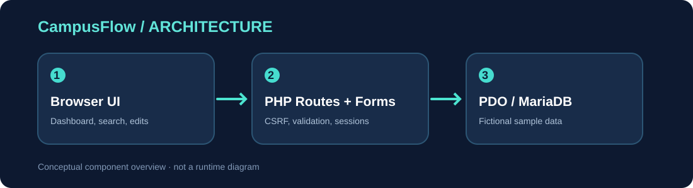

<p align="center"></p>
<p align="center"><strong>Full-stack student management</strong></p>
<p align="center"><code>PHP · MariaDB · JavaScript</code></p>

> **Portfolio learning project / AI-assisted starter.** This project demonstrates skills under development; tests and deployment limits are disclosed below. All examples are fictional.

**Project tour:** [Features](#screens--features) · [Architecture](#architecture-at-a-glance) · [Run locally](#local-quick-start) · [Testing and limitations](#verification-status)

## Architecture at a glance



## Verification status

PHP syntax and core helper tests passed; full Docker+database integration not verified. These checks do not certify the app as production-ready.

# CampusFlow — Student Management Web App


A modern, responsive **PHP + MariaDB (MySQL-compatible)** portfolio application for managing fictional students, courses, enrollments and grades. Includes a dashboard with participation bars, searchable directories, edit/create/delete forms, and a local admin sign-in.

**Scope:** Learning/portfolio demonstration only. Not a real student information system; do not put real students' sensitive information in it.

## Screens / features

- **Dashboard:** student, course, enrollment metrics and average graded score
- **Students:** add, edit, search and remove records
- **Courses:** add, edit, search and remove courses
- **Enrollments:** assign students to courses; update grade or mark in progress
- **Security basics:** parameterized SQL, output escaping, CSRF tokens, secure-ish session settings, application-level validation, admin sign-in
- **Fictional demo data** loaded on first database initialization

## Local quick start

Requires Docker Desktop with Docker Compose (recommended on Windows, macOS or Linux).

```bash
cp .env.example .env
# Edit .env and choose long, unique values for every password.
docker compose up --build -d
```

Open **http://localhost:8080**; sign in with the password you set as `ADMIN_PASSWORD` in `.env`.

To reset fictional demo records: `docker compose down -v && docker compose up --build -d` (deletes local database contents).

## Quality checks

With PHP installed locally: `bash scripts/check-syntax.sh`.

The PHP code has been syntax-checked using PHP 8.4. Full database + UI integration requires a working Docker/MariaDB instance and should be verified before any public deployment.

## Technical details

- `public/index.php`: application routing, POST handlers and HTML templates
- `app/bootstrap.php`: PDO connection, CSRF, authentication helpers, validation
- `database/schema.sql`: schema plus sample records (fictional)
- `public/assets/`: responsive styles and client-side table search
- `compose.yaml`, `Dockerfile`: local isolated runtime

## Security / deployment notes

**Local demo only**. The application binds to `127.0.0.1` and should not be exposed publicly without additional work: persistent login accounts with hashed passwords and rate limiting, HTTPS, permissions/roles, security testing, backup policy, and privacy compliance. Never commit `.env` or actual student records. Do not use the default example password.

This project is self-contained and needs no paid hosting for local review; GitHub stores the source code, while live PHP/MariaDB hosting would be separate.

## License

MIT; see LICENSE.

## Portfolio attribution / next steps

This project began as an **AI-assisted portfolio starter**. Before adding it to an academic application, review the code, run the app, make improvements you understand, and describe your actual role accurately. Do not present generated code as entirely hand-written or portray fictional demonstration data as real records.
